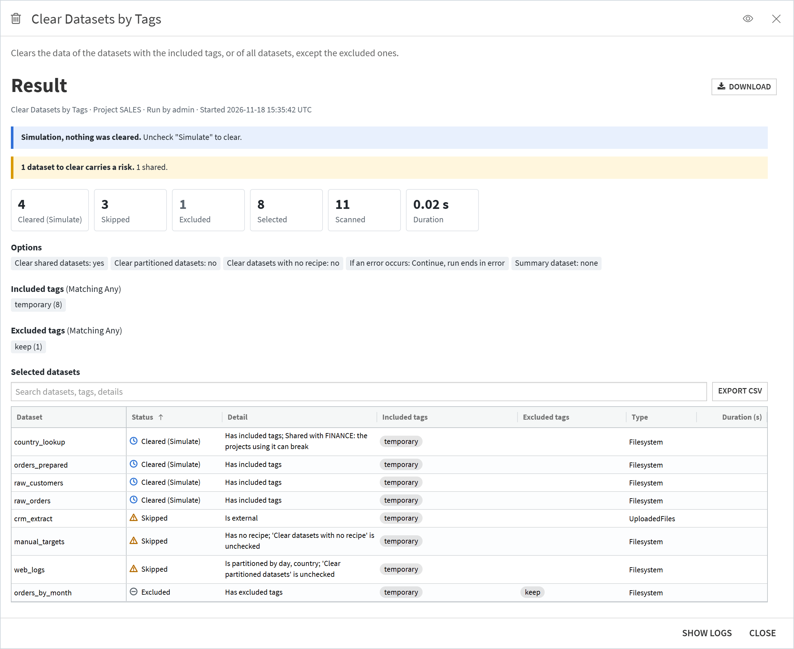
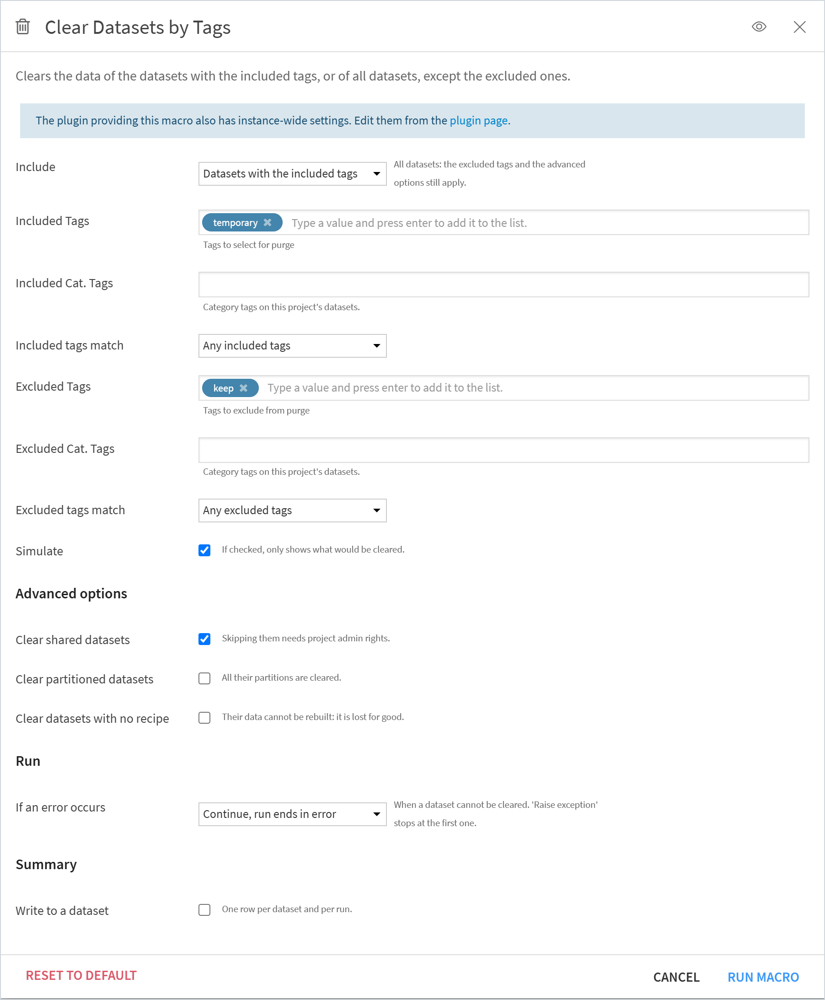
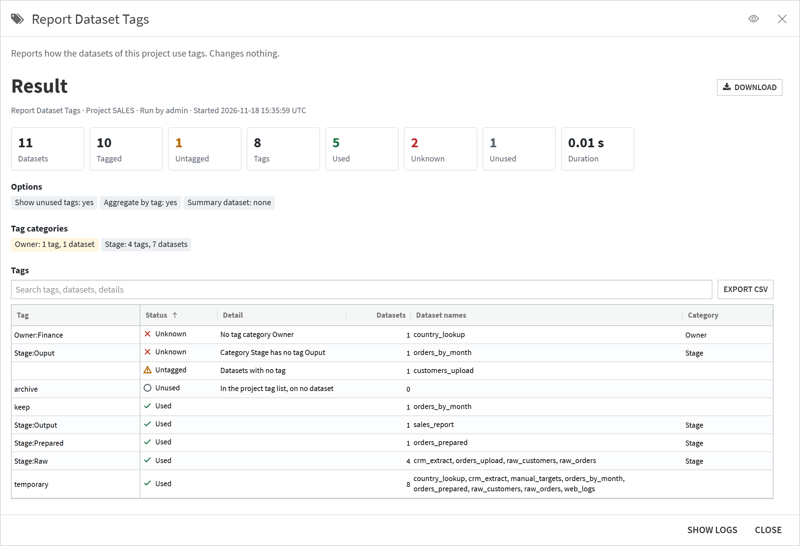
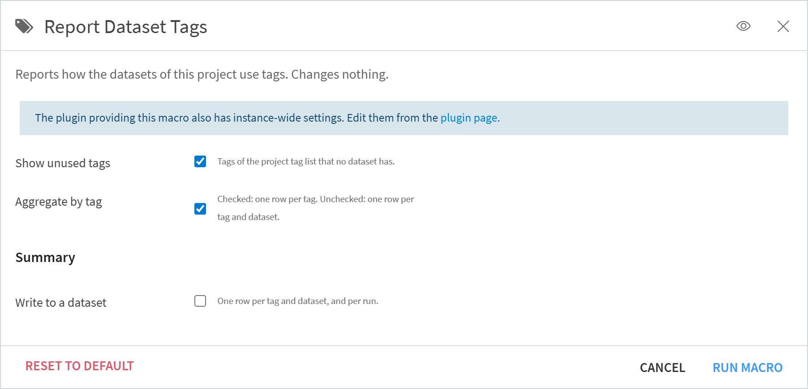

# Dataiku Plugin - Clear Datasets by Tags

[](https://github.com/Zyniel/dss-plugin-clear-datasets-by-tags/actions/workflows/ci.yml)
[](https://github.com/Zyniel/dss-plugin-clear-datasets-by-tags/releases)
[](LICENSE)


**Clear Datasets by Tags** is a plugin for Dataiku (DSS) with macros to maintain projects: it clears the data of the datasets that match tag rules, and reports how the datasets use tags. A macro that changes data simulates by default: it shows what it would do before it changes anything.

> Community plugin: not affiliated with, supported or endorsed by Dataiku. For questions and bugs, open an [issue](https://github.com/Zyniel/dss-plugin-clear-datasets-by-tags/issues).

## The macros

They are in the **Project maintenance** section of the **Macros** page of a project.

### Clear Datasets by Tags

Clears the data of the datasets that match its tag rules: the datasets with the included tags, or all of them, minus the ones with the excluded tags. The definitions, schemas and settings of the datasets stay. Simulates by default.

Documentation: [user guide](docs/macros/clear-datasets-by-tags/user-guide.md), [automation](docs/macros/clear-datasets-by-tags/automation.md).



The recap of a simulation: 4 datasets would be cleared, and 1 of them is shared. 3 are skipped: external, partitioned, with no recipe. 1 is excluded.

<details>
<summary>The form</summary>



The included tag `temporary`, the excluded tag `keep`, and **Simulate** checked.

</details>

### Report Dataset Tags

Reports how the datasets use tags: tags in use, unused tags, unknown category tags, untagged datasets. Changes nothing.

Documentation: [user guide](docs/macros/report-dataset-tags/user-guide.md), [automation](docs/macros/report-dataset-tags/automation.md).



The recap: 2 unknown tags, `Owner:Finance` and `Stage:Ouput` (a typo), 1 dataset with no tag, and 1 tag of the project on no dataset.

<details>
<summary>The form</summary>



Its default values.

</details>

## Requirements

- DSS 13 or later.
- Nothing else to install: the plugin runs in the built-in Python 3.9 environment of DSS, with no code environment.

## Install

1. Download `dss-plugin-clear-datasets-by-tags-<version>.zip` from the [latest release](https://github.com/Zyniel/dss-plugin-clear-datasets-by-tags/releases/latest).
2. In DSS, as an administrator: **Plugins > Add plugin > Upload**, then select the zip. DSS lists the plugin as **Clear Datasets by Tags**, with the id `clear-datasets-by-tags`. To update, read the [CHANGELOG](CHANGELOG.md), then upload the new zip in **Plugins > Installed > Clear Datasets by Tags**.
3. Set the [plugin settings](#plugin-settings) if needed.

To build the zip from the sources, see [development](docs/development.md#build-the-zip).

## Quick start

In DSS:

1. In a project, open **Macros** and select **Clear Datasets by Tags**.
2. Give the included tags, such as `temporary`, keep **Simulate** checked, and run the macro.
3. Read the recap: what would be cleared, what is skipped and why. Then uncheck **Simulate** and run it again.

From Python, in a notebook or a scenario of DSS:

```python
import dataiku

project = dataiku.api_client().get_default_project()
macro = project.get_macro("pyrunnable_clear-datasets-by-tags_clear-datasets-by-tags")
run_id = macro.run(params={"included_tags": ["temporary"]})  # A simulation: nothing is cleared
```

Add `"simulate": False` to clear. The parameters and the result are in [automation](docs/macros/clear-datasets-by-tags/automation.md).

## Plugin settings

An administrator sets them in **Plugins > Installed > Clear Datasets by Tags > Settings**. The details are in the [admin guide](docs/admin-guide.md#plugin-settings).

| Setting | Default | Use |
|---|---|---|
| AG Grid URL | AG Grid Community on cdn.jsdelivr.net | Where a downloaded recap loads its interactive table from. Empty: a simple table. |
| AG Grid integrity hash | The hash of that file | The browser loads the file only if it has this hash. |
| Tag categories | Empty: all categories | The categories that the "Cat. Tags" lists of the forms offer, such as `Stage`. |

## Documentation

| Document | Content |
|---|---|
| [Admin guide](docs/admin-guide.md) | For DSS administrators: install, settings, rights, what the macros change, network. |
| [Architecture](docs/architecture.md) | How the code is split, the import rules, the steps of a run. |
| [Development](docs/development.md) | Set up, the repository layout, the checks and the tests, build the zip, release a version. |
| [Add a macro](docs/adding-a-macro.md) | The steps, in order, to add a macro to the plugin. |
| [Verification](docs/verification.md) | What the tests prove, and the checks to do on a real DSS. |
| [Integration tests](docs/integration-tests.md) | Run the macros on a real DSS, as an administrator, an editor and a reader. |
| [Screenshots](docs/screenshots.md) | Take the screenshots of this README again, on a test DSS. |
| [CHANGELOG](CHANGELOG.md) | What changes in each version. |

## Contributing

Bug reports and pull requests are welcome: see [contributing](.github/CONTRIBUTING.md). Report a vulnerability privately, as the [security policy](.github/SECURITY.md) explains.

## License

[MIT](LICENSE)
